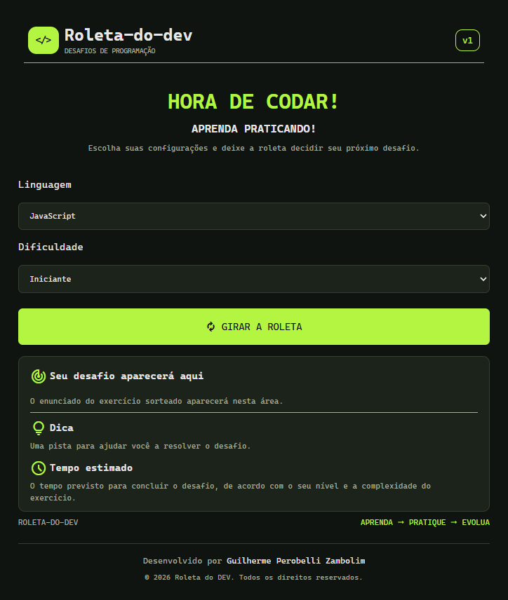

# Roleta-do-DEV

**Aprenda praticando. Desafie-se. Evolua como desenvolvedor!**

O **Roleta-do-DEV** é uma aplicação Full Stack em desenvolvimento, criada para incentivar a prática de programação por meio de desafios aleatórios personalizados de acordo com a linguagem de programação e o nível de dificuldade selecionados pelo usuário.

A aplicação disponibiliza um catálogo com **3.600 exercícios**, distribuídos entre seis linguagens de programação e seis níveis de dificuldade.

Ao girar a roleta, o usuário recebe um desafio compatível com as opções selecionadas, contendo enunciado, dica e tempo estimado para resolução, acompanhado de um cronômetro regressivo.

O projeto começou como uma aplicação desenvolvida com HTML5, CSS3 e JavaScript e evoluiu para uma arquitetura baseada em **React, TypeScript e Node.js**, com o objetivo de consolidar conhecimentos em desenvolvimento Full Stack.

## Demonstração online

Em desenvolvimento.

## Preview



## Funcionalidades

### Implementadas

**Front-End**

- Interface com tema escuro e detalhes em verde-limão.
- Seleção de linguagem de programação:
  - JavaScript.
  - Python.
  - Java.
  - C#.
  - C++.
  - PHP.
- Seleção do nível de dificuldade:
  - Iniciante.
  - Estagiário.
  - Júnior.
  - Pleno.
  - Sênior.
  - Mas que P@#...
- Exibição dinâmica do enunciado e da dica do exercício sorteado.
- Temporizador regressivo baseado no tempo estimado de cada desafio.
- Atualização do cronômetro a cada segundo utilizando `setInterval()`.
- Gerenciamento de estados com `useState`.
- Utilização de `useEffect` para controlar o ciclo de execução do temporizador.
- Limpeza de intervalos com `clearInterval()`.
- Organização da interface em componentes reutilizáveis com React.
- Tipagem dos dados e propriedades utilizando TypeScript.
- Estilização com Tailwind CSS.

**Back-End**

- Servidor desenvolvido com Node.js e Express.
- API REST para consulta e sorteio de desafios.
- Importação dos seis arquivos JSON contendo os exercícios.
- Organização dos desafios por linguagem e dificuldade.
- Função para localizar os exercícios correspondentes às opções selecionadas.
- Função para realizar o sorteio aleatório de um desafio.
- Tratamento de situações em que não existem desafios disponíveis.
- Retorno de dados no formato JSON.
- Utilização de códigos de status HTTP.
- Configuração de CORS para permitir a comunicação entre Front-End e Back-End.

**Integração**

- Comunicação entre React e Express utilizando `fetch()`.
- Utilização de `async/await` para trabalhar com requisições assíncronas.
- Tratamento de erros com `try/catch`.
- Verificação de respostas HTTP com `response.ok`.
- Conversão das respostas da API utilizando `response.json()`.
- Atualização do desafio exibido e do cronômetro com os dados recebidos do Back-End.

### Planejadas

- Configurar um banco de dados PostgreSQL.
- Integrar o Prisma ORM ao Back-End.
- Criar o modelo de dados dos desafios.
- Executar migrations e compreender a persistência dos dados.
- Substituir a leitura dos arquivos JSON por consultas ao banco de dados.
- Implementar testes automatizados.
- Aprimorar validações e tratamento de erros.
- Implementar histórico de exercícios sorteados.
- Evitar a repetição de desafios já realizados.
- Permitir marcar desafios como concluídos.
- Implementar controles para iniciar, pausar e reiniciar o cronômetro.
- Desenvolver funcionalidades de pontuação e acompanhamento de progresso.

**Status do projeto:** em desenvolvimento. A primeira versão funcional da API REST já está integrada ao Front-End e utiliza os 3.600 exercícios armazenados em arquivos JSON. As próximas etapas envolvem a implementação do PostgreSQL e do Prisma ORM, além da publicação da aplicação para acesso público.

## Tecnologias utilizadas

### Front-End

- **React:** construção da interface e organização dos componentes reutilizáveis.
- **TypeScript:** tipagem estática dos dados, propriedades e estados da aplicação.
- **Tailwind CSS:** estilização dos elementos por meio de classes utilitárias.
- **Vite:** ambiente de desenvolvimento e inicialização da aplicação.

### Back-End

- **Node.js:** ambiente de execução JavaScript no servidor.
- **Express:** criação do servidor e gerenciamento das rotas da API REST.
- **JavaScript:** implementação da lógica de consulta e sorteio dos desafios.
- **CORS:** configuração da comunicação entre diferentes origens.
- **JSON:** armazenamento e organização dos exercícios.

### Ferramentas

- **Git:** controle de versão.
- **GitHub:** armazenamento e versionamento do código-fonte.

## Funcionamento da aplicação

O funcionamento da Roleta do DEV envolve a comunicação entre o Front-End e o Back-End.

1. O usuário seleciona uma linguagem de programação.
2. Seleciona o nível de dificuldade desejado.
3. Ao clicar no botão para girar a roleta, o React executa uma função assíncrona.
4. A aplicação realiza uma requisição HTTP utilizando `fetch()`.
5. A requisição é direcionada à API Express, informando a linguagem e a dificuldade selecionadas.
6. O Back-End identifica os desafios correspondentes nos arquivos JSON.
7. Uma função realiza o sorteio aleatório de um exercício.
8. O desafio selecionado é retornado pela API no formato JSON.
9. O Front-End recebe a resposta e atualiza o estado da aplicação.
10. O exercício, a dica e o cronômetro são apresentados dinamicamente na interface.

### Exemplo de requisição

```http
GET /desafios/javascript/iniciante/sortear
```

A API recebe a linguagem e a dificuldade por meio dos parâmetros da rota, localiza os exercícios correspondentes e retorna um desafio aleatório.

## Organização do Back-End

O Back-End foi organizado para separar os dados, a lógica de manipulação dos desafios e a inicialização do servidor.

- **data/arquivosDesafios.js:** importa os seis arquivos JSON e organiza os exercícios em um objeto identificado pela linguagem.
- **data/*.json:** arquivos que armazenam os 3.600 exercícios, distribuídos entre as seis linguagens.
- **utils/desafios.js:** contém as funções responsáveis por localizar os desafios de acordo com a linguagem e a dificuldade e realizar o sorteio aleatório.
- **server.js:** inicializa o servidor Express, configura os middlewares e define as rotas da API.

### Funções principais

**acharDesafio(linguagem, dificuldade)**

Recebe a linguagem e a dificuldade selecionadas, verifica a existência da combinação e retorna o array de exercícios correspondente. Caso não encontre os dados, retorna `null`.

**sortearDesafio(desafioFiltrados)**

Recebe o array de exercícios filtrados, calcula um índice aleatório utilizando `Math.random()` e `Math.floor()` e retorna um único desafio. Caso não existam exercícios disponíveis, retorna `null`.

## Organização do Front-End

A interface foi desenvolvida com React e organizada em componentes reutilizáveis.

- **Header:** apresentação da identidade visual, nome e versão da aplicação.
- **SeletorDesafio:** disponibiliza os campos de seleção de linguagem e dificuldade e o botão para iniciar o sorteio. Recebe os valores atuais e comunica as alterações ao componente principal por meio de callbacks.
- **ResultadoDesafio:** apresenta o enunciado, a dica e o temporizador do exercício sorteado. Recebe o desafio e o tempo restante por meio de Props.
- **Footer:** apresentação das informações de identificação e dos créditos do projeto.
- **App:** componente principal responsável por organizar os componentes, gerenciar os estados, realizar a requisição à API e controlar o temporizador.

Os componentes se comunicam por meio de Props e callbacks, enquanto o componente principal mantém os estados compartilhados da aplicação.

## Temporizador

O temporizador regressivo utiliza o tempo estimado de cada exercício, armazenado em minutos nos arquivos JSON.

Ao receber um desafio da API, o Front-End converte o tempo estimado para segundos e atualiza o estado `tempoRestante`.

A implementação utiliza:

- **useState:** armazenamento e atualização do tempo restante.
- **useEffect:** execução do efeito quando o valor de `tempoRestante` é alterado.
- **setInterval():** decremento do contador a cada segundo.
- **clearInterval():** limpeza do intervalo anterior.
- **Math.floor() e operador módulo (%):** conversão dos segundos restantes para minutos e segundos.
- **padStart():** formatação dos valores para apresentar o temporizador no formato MM:SS.

## Estrutura dos dados

Os exercícios estão distribuídos em seis arquivos JSON, localizados na pasta `backend/data/`:

- `javascript.json`
- `python.json`
- `java.json`
- `csharp.json`
- `cpp.json`
- `php.json`

Cada arquivo organiza os exercícios de sua respectiva linguagem em seis níveis de dificuldade, contendo 100 exercícios por combinação.

Cada exercício possui informações como:

- Identificador.
- Título.
- Categoria.
- Descrição.
- Dica.
- Tempo estimado.

A estrutura dos dados é centralizada no arquivo `arquivosDesafios.js`, responsável por importar os JSON e disponibilizá-los ao restante do Back-End.

Atualmente, os exercícios são carregados diretamente dos arquivos JSON, sem necessidade de consultas a um banco de dados.

## Como executar o projeto

É necessário ter o Node.js e o npm instalados.

### 1. Clonar o repositório

```bash
git clone https://github.com/GuilhermePerobelliZambolim/roleta-do-dev.git
```

### 2. Instalar as dependências do Back-End

```bash
cd roleta-do-dev/backend
npm install
```

### 3. Iniciar o servidor Back-End

```bash
node server.js
```

O servidor será iniciado na porta 3000.

### 4. Instalar as dependências do Front-End

Abra outro terminal:

```bash
cd roleta-do-dev/frontend
npm install
```

### 5. Iniciar o Front-End

```bash
npm run dev
```

Acesse o endereço disponibilizado pelo Vite no terminal, normalmente:

```text
http://localhost:5173
```

Com os dois servidores em execução, o Front-End poderá realizar requisições à API local.

## Estrutura do projeto

```text
roleta-do-dev/
├── backend/
│   ├── data/
│   │   ├── arquivosDesafios.js
│   │   ├── cpp.json
│   │   ├── csharp.json
│   │   ├── java.json
│   │   ├── javascript.json
│   │   ├── php.json
│   │   └── python.json
│   ├── utils/
│   │   ├── desafios.js
│   │   └── mensagem.js
│   ├── hotel.js
│   ├── index.js
│   ├── server.js
│   ├── package.json
│   └── package-lock.json
├── frontend/
│   ├── src/
│   │   ├── assets/
│   │   ├── components/
│   │   │   ├── Footer.tsx
│   │   │   ├── Header.tsx
│   │   │   ├── ResultadoDesafio.tsx
│   │   │   └── SeletorDesafio.tsx
│   │   ├── App.tsx
│   │   ├── index.css
│   │   ├── main.tsx
│   │   └── types.ts
│   ├── index.html
│   ├── package.json
│   ├── package-lock.json
│   └── vite.config.ts
├── versao-antiga/
│   ├── index.html
│   └── index.css
└── README.md
```

**Observação:** a pasta `versao-antiga/` preserva os arquivos da versão original do projeto, desenvolvida antes da migração para React.

## Objetivo do projeto

O objetivo do Roleta-do-DEV é incentivar a prática constante de programação, oferecendo desafios que estimulem o raciocínio lógico, a resolução de problemas e o desenvolvimento da autonomia como programador.

O projeto faz parte da minha jornada de aprendizado em desenvolvimento Web e surgiu da vontade de construir uma aplicação própria, que pudesse evoluir junto com meus conhecimentos, desde a construção da interface até a implementação de um Back-End e a integração com um banco de dados.

Durante o desenvolvimento, procuro aplicar e consolidar os conhecimentos adquiridos nos estudos, especialmente durante minha formação na **OneBitCode**.

Entre os principais conhecimentos trabalhados estão:

- Desenvolvimento de interfaces com React.
- Utilização de TypeScript e tipagem de dados.
- Criação e reutilização de componentes.
- Gerenciamento de estados com `useState`.
- Comunicação entre componentes por meio de Props e callbacks.
- Manipulação de arrays e objetos.
- Criação de funções e separação de responsabilidades.
- Utilização de `Math.random()` e `Math.floor()`.
- Manipulação de estados e efeitos com `useEffect`.
- Controle de intervalos utilizando `setInterval()` e `clearInterval()`.
- Criação de APIs REST com Node.js e Express.
- Comunicação entre Front-End e Back-End utilizando `fetch()`.
- Programação assíncrona com `async/await`.
- Tratamento de erros com `try/catch`.
- Organização e versionamento do projeto utilizando Git e GitHub.

## Autor

**Guilherme Perobelli Zambolim**

- [GitHub](https://github.com/GuilhermePerobelliZambolim)
